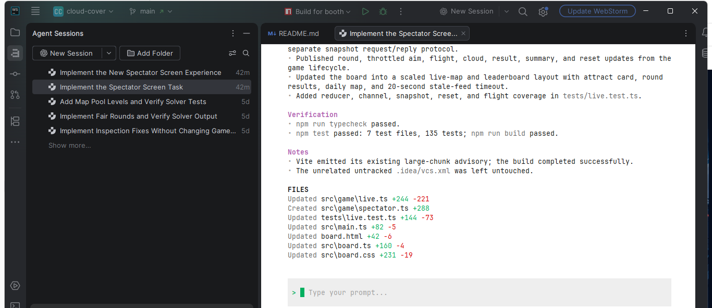

# JetBrains Air session: task 008, live spectator screen

- **Date:** 25 Nov 2026
- **Where:** WebStorm 2026.3, Agent Sessions (the bundled JetBrains Air plugin), project `cloud-cover`
- **Agent:** Junie 26.11.2, started from the Air session ("Use in Terminal", after Air's own Junie download failed on this network)
- **Brief:** [`.junie/tasks/008-spectator-screen.md`](../../.junie/tasks/008-spectator-screen.md)
- **Prompt:** `Do the task in .junie/tasks/008-spectator-screen.md. Read .junie/guidelines.md first. Follow the file list in the task exactly.`

## What the agent did

- New `src/game/live.ts`: typed live messages over a `BroadcastChannel`, a pure reducer for the board's view of
  the run, and a snapshot request so a board opened mid-run catches up at once.
- New `src/game/spectator.ts`: the top-down live map (blocks, crossing, watcher view fans, landing ring, cloud).
- `src/main.ts`: publishes round, aim (10 per second), flight, cloud, result, summary and idle events.
- `board.html`, `src/board.ts`, `src/board.css`: NOW PLAYING panel beside TODAY'S BEST, attract card after
  20 seconds without a live message.
- `tests/live.test.ts`: reducer, channel, snapshot and reset tests. Typecheck, 135 tests and the build passed.

The session list shows the task twice: two sessions picked up the same prompt and ran side by side. Both finished
on the same files; the final tree was checked as a whole.

## Human review afterwards

- Played a round in one window with `board.html` open in another: the board followed aim, live % hidden, cloud and
  result, and returned to the attract card 20 seconds after the game window closed. No console errors.
- One fix: the live readout label said `% HIDDEN` after a number that already ends in `%`; changed to `HIDDEN`.
